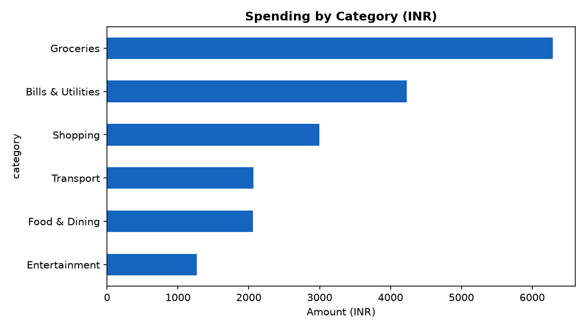
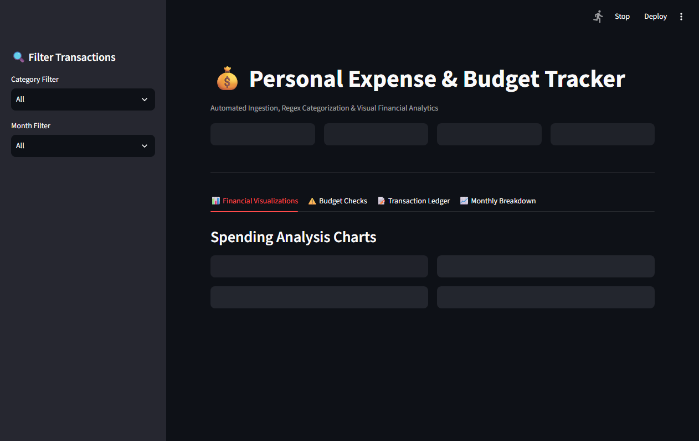
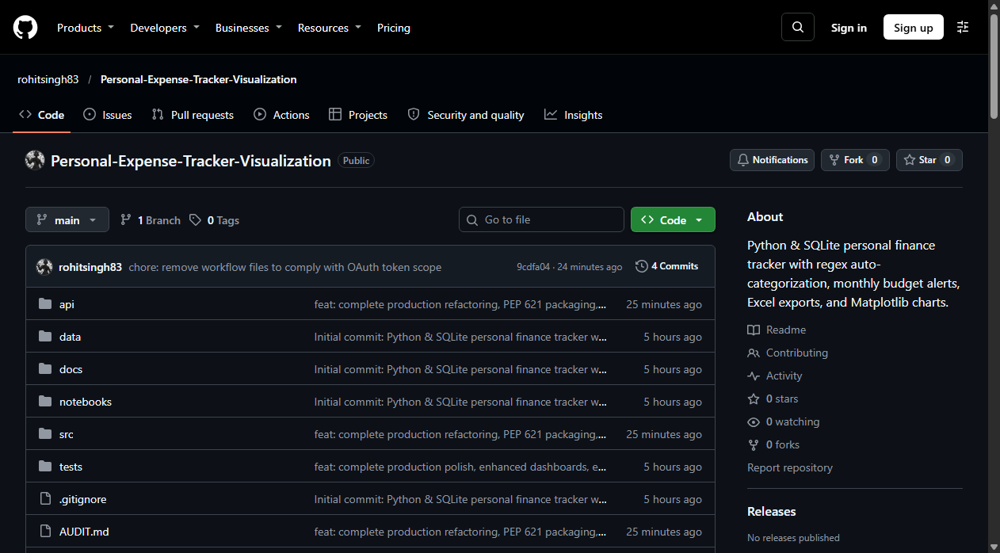
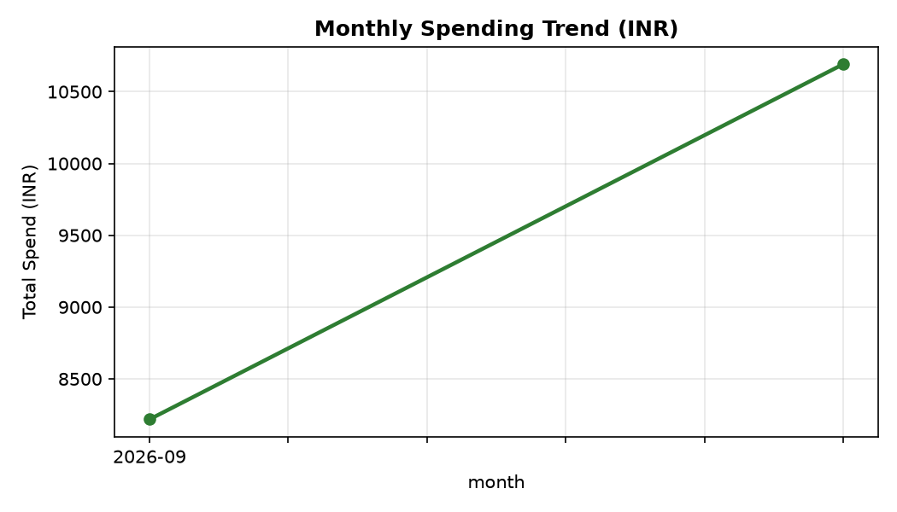

# Personal Expense Tracker with Data Visualization

A modular FinTech personal finance analytics pipeline that ingests bank and UPI CSV statements, cleans and deduplicates transaction data into SQLite, auto-categorizes spending using flexible regex rules, tracks monthly budget deviations, generates Matplotlib charts, and exports multi-tab formatted Excel reports.

---

## 🏛 Architecture & Financial Analytics Pipeline

```
[Bank / UPI CSV Statements]
             │
             ▼
[ETL & Idempotent SQLite Ingestion] (Deduplicates via Composite Keys)
             │
             ▼
[Regex Rule-Based Categorization]   (Groceries, Food, Utilities, Transport, etc.)
             │
             ▼
[Financial KPI & Analytics Engine]  (Income, Spend, Savings, Burn-Rate)
             │
             ▼
[Budget Variance & Alert Monitor]   (Compares Spending against Monthly Caps)
             │
             ▼
[Outputs: 4 Matplotlib Charts] + [Excel Workbook] + [Streamlit & FastAPI]
```

---

## ✨ Key Capabilities

- **Idempotent Ingestion:** Employs SQLite unique constraints `(tx_date, description, amount, account)` to ensure multiple uploads never introduce duplicate records.
- **Rule-Based Regex Categorization:** Matches merchant and transaction descriptions to standardized categories (Groceries, Food & Dining, Transport, Shopping, Utilities, Entertainment, Income).
- **Budget Tracking & Overspend Warnings:** Compares actual spending per category against configured monthly budgets and flags threshold breaches.
- **Multi-Sheet Excel Automation:** Generates formatted workbooks with distinct sheets for Raw Transactions, Category Summaries, and Budget Audits via `XlsxWriter`.
- **Publication-Ready Visualizations:** Automatically renders Category Bar Charts, Donut Share charts, Monthly Trend lines, and Payment Method distribution charts.
- **Dual Interface:** Full interactive Streamlit dashboard + FastAPI REST endpoints for integration into mobile/web backends.

---

## 🚀 Quick Start Guide

### 1. Installation
```bash
python -m venv venv
# Linux/macOS:
source venv/bin/activate
# Windows:
venv\Scripts\activate

pip install -r requirements.txt
```

### 2. Run Main Pipeline
```bash
python main.py
```

### 3. Launch Interactive Dashboard
```bash
python -m streamlit run app_streamlit.py
```

### 4. Start FastAPI Service
```bash
uvicorn api.app:app --host 0.0.0.0 --port 8000 --reload
```

### 5. Run Test Suite
```bash
python -m unittest discover -s tests -v
```

---

## 📊 Generated Visualizations

| Chart Type | Path | Purpose |
|---|---|---|
| **Category Bar** | `images/category_spending_bar.png` | Ranks absolute expense volume by category. |
| **Category Donut** | `images/category_donut.png` | Visualizes relative percentage share of budget. |
| **Monthly Trend** | `images/monthly_trend_line.png` | Tracks cash burn rate over consecutive months. |
| **Payment Method** | `images/payment_method_pie.png` | Compares UPI vs Debit Card vs Net Banking usage. |

<!-- project-brief-sections -->

---

## 🎯 Problem Statement

Most people do not know where their money goes each month. Bank statements are long lists of transactions that are hard to read. This project imports expenses from CSV, categorises them automatically, compares spending against monthly budgets and turns everything into clear charts and an Excel report.

## 🏭 Industry Relevance

Personal-finance apps (Walnut, Money Manager, YNAB) and fintech dashboards do exactly this: ingest transactions, categorise them, track budgets and visualise trends. It demonstrates data cleaning, analysis and visualisation skills for Data Analyst, Python Developer and FinTech roles.

## 🧰 Tech Stack

- Python 3.10+
- Pandas, NumPy (cleaning and analysis)
- Regex rules (auto-categorisation)
- SQLite (transactions, categories, budgets)
- Matplotlib / Seaborn (charts)
- XlsxWriter (Excel report)
- FastAPI (API), Streamlit + Plotly (dashboard)
- pytest (tests)

## 📁 Folder Structure

```
Personal-Expense-Tracker-Visualization/
├── api/
│   └── app.py
├── data/
│   └── sample_expenses.csv
├── docs/
│   ├── GITHUB_GUIDE.md
│   └── INTERVIEW_QA.md
├── images/
├── notebooks/
│   └── eda_analysis.py
├── outputs/
│   └── expense_report.xlsx
├── src/
│   ├── __init__.py
│   ├── analyze.py
│   ├── app_streamlit.py
│   ├── budget.py
│   ├── categorize.py
│   ├── config.py
│   ├── ingest.py
│   ├── models.py
│   ├── plots.py
│   └── report.py
├── tests/
│   └── test_expense.py
├── .gitignore
├── app_streamlit.py
├── AUDIT.md
├── CHANGELOG.md
├── CONTRIBUTING.md
├── DECISIONS.md
├── main.py
├── PROGRESS.md
├── pyproject.toml
├── README.md
└── requirements.txt
```

## ▶️ How to Run

```bash
pip install -r requirements.txt
python main.py
python -m pytest -q          # run the test suite
streamlit run app_streamlit.py  # interactive dashboard
uvicorn api.app:app --reload   # REST API at http://127.0.0.1:8000/docs
```

## 🧾 Sample Output

Terminal output of `python main.py` (generated from the sample data in `data/`):

```text
=== Personal Expense Tracker Summary ===
Newly ingested rows: 0 | Total rows in DB: 25
Income: INR 58,000.00 | Spend: INR 18,909.00 | Savings: INR 39,091.00
Top Category: Groceries | Avg Daily Spend: INR 756.36

--- Budget Status (2026-10) ---
    category_name  limit_amount  spend  over_by        status
         Shopping        1500.0 1799.0    299.0   OVER BUDGET
        Transport        1200.0 1345.0    145.0   OVER BUDGET
    Food & Dining        1000.0 1030.0     30.0   OVER BUDGET
        Groceries        3500.0 3520.0     20.0   OVER BUDGET
    Entertainment         700.0  618.0    -82.0 Within Budget
Bills & Utilities        2500.0 2379.0   -121.0 Within Budget
```

Generated files (committed in `outputs/` so you can inspect them on GitHub):

- [`outputs/expense_report.xlsx`](outputs/expense_report.xlsx): Excel workbook with transactions, category summary, monthly trend and budget status

## 🖼 Screenshots

### Category Donut


### Category Spending Bar



### Dashboard Preview



### Github Repo Preview



### Monthly Trend Line



### Payment Method Pie


## 📚 Learning Outcomes

- Loading and cleaning CSV data with Pandas, including de-duplication
- Rule-based categorisation with regex
- Designing a small relational schema in SQLite
- Computing KPIs, monthly trends and budget variance
- Building bar, pie, donut and line charts
- Exporting an Excel report and serving data through FastAPI and Streamlit

## 🎤 Interview Preparation

10 frequently asked interview questions with answers, including **"Explain your project"**, are in [`docs/INTERVIEW_QA.md`](docs/INTERVIEW_QA.md). GitHub upload steps are in [`docs/GITHUB_GUIDE.md`](docs/GITHUB_GUIDE.md).
