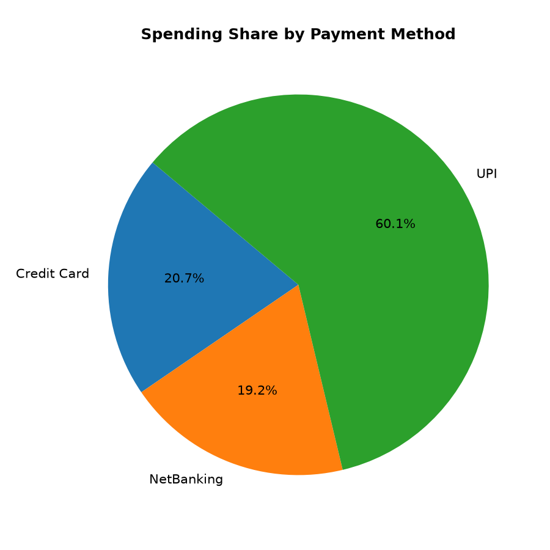

# Personal Expense Tracker with Data Visualization

A modular Python financial analytics pipeline that ingests bank/UPI CSV exports, deduplicates and stores transactions in SQLite, auto-categorizes expenses via regex rules, tracks monthly budgets, exports formatted Excel reports, and generates Matplotlib visualizations.

## Problem Statement & Industry Relevance
Tracking expenses across UPI, cards, and bank transfers manually is error-prone. Automated ingestion, categorization, and budget alerting form the core of modern FinTech personal finance apps.

## Tech Stack
- **Language & Data:** Python 3.11, Pandas, NumPy, SQLite
- **Visualization & Reporting:** Matplotlib, Seaborn, XlsxWriter, Streamlit

## Setup & How to Run
```bash
python -m venv venv
source venv/bin/activate
pip install -r requirements.txt
python main.py
python -m unittest discover -s tests -v
```

## Generated Charts




## Learning Outcomes
- Idempotent ETL ingestion with SQLite constraints
- Financial KPI modeling, budget variance tracking, and multi-sheet Excel automation
