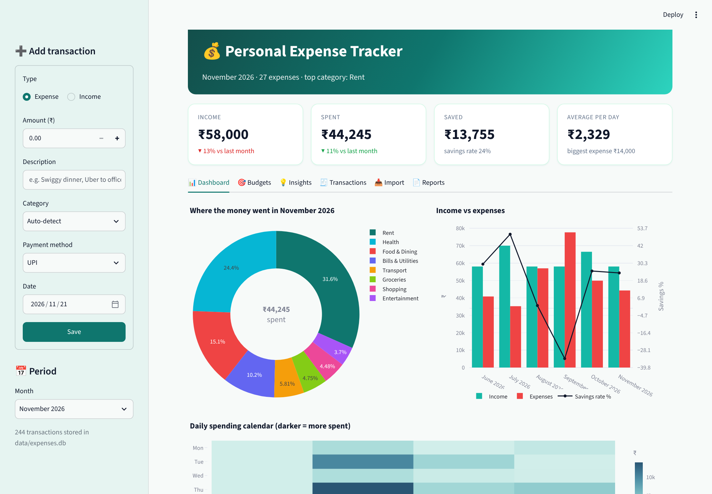
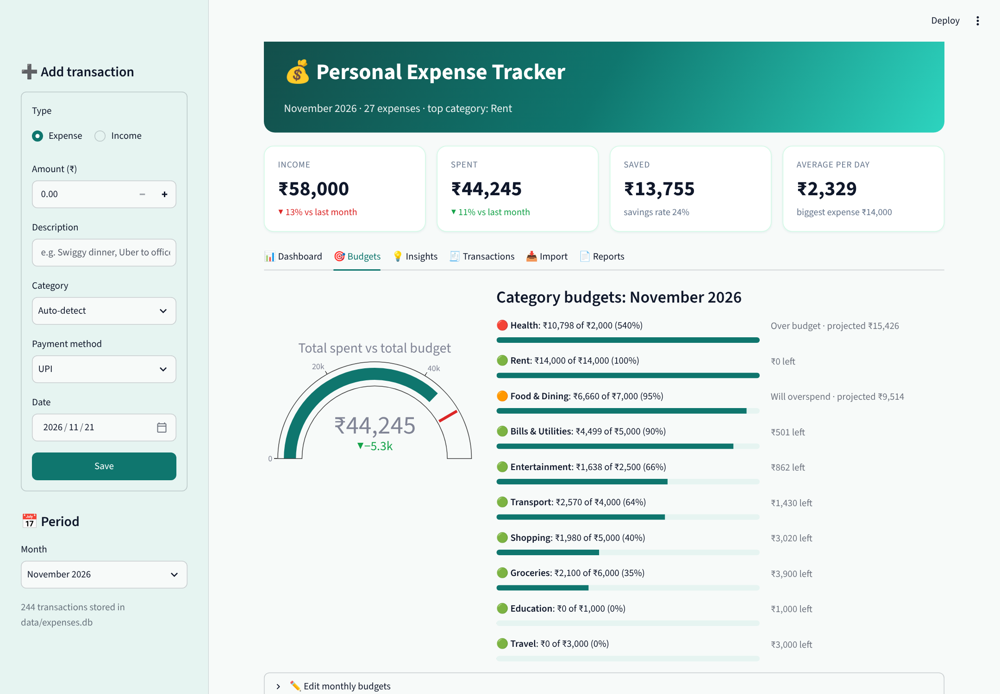
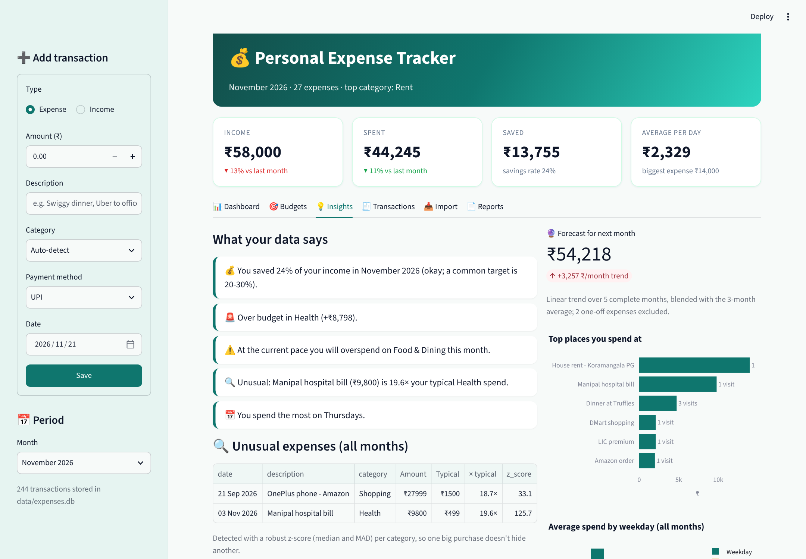
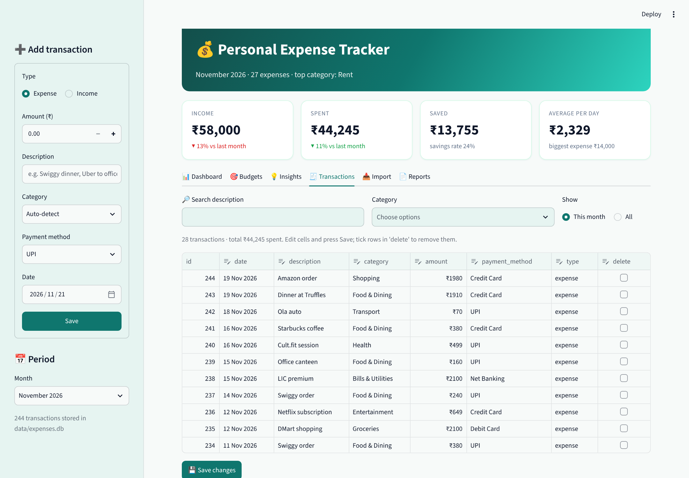
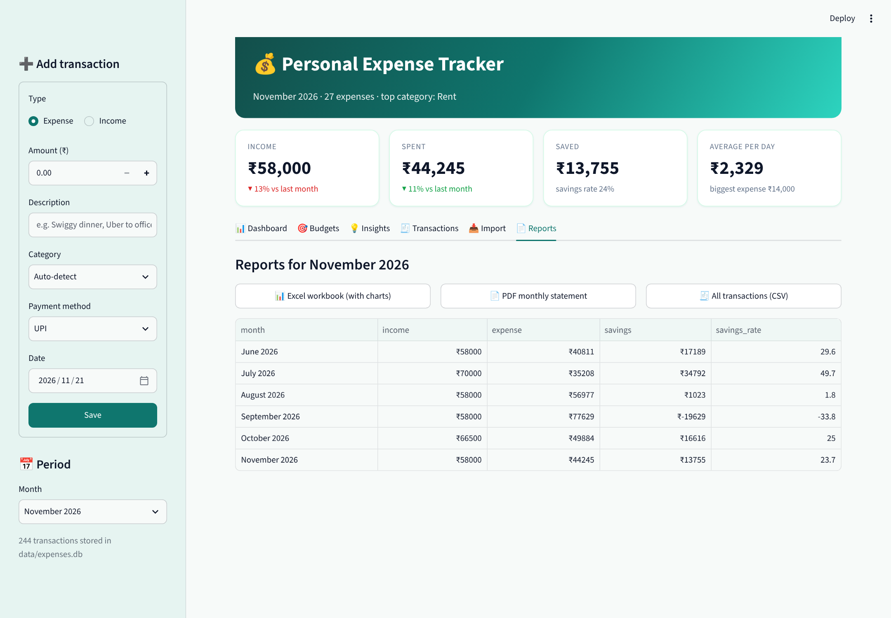
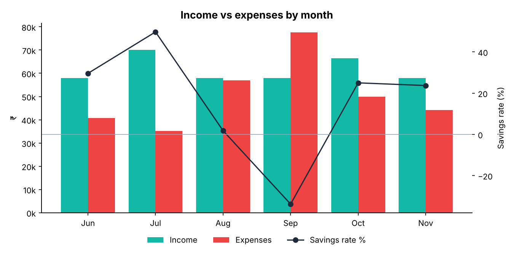
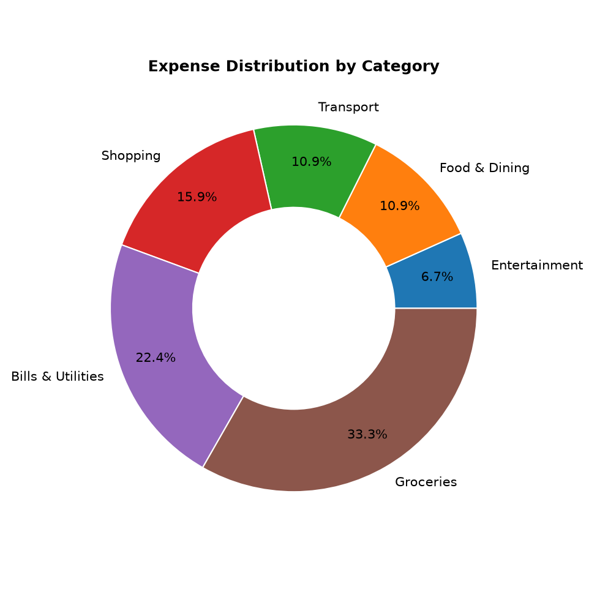
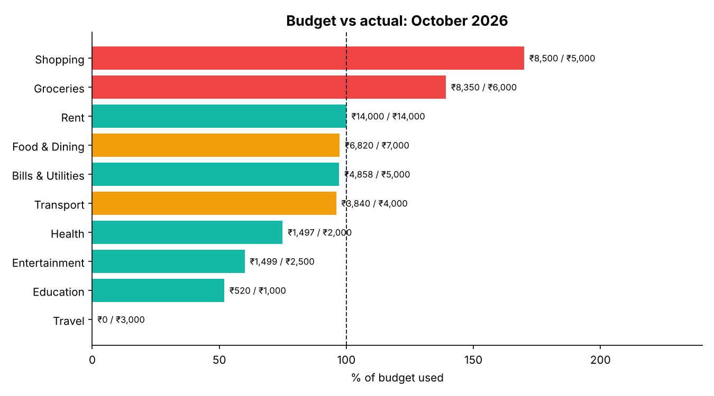
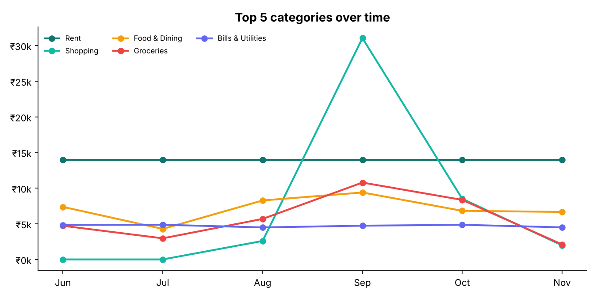

# Personal Expense Tracker with Data Visualization

🌐 **Live report:** https://rohitsingh83.github.io/Personal-Expense-Tracker-Visualization/ · 💻 **Source:** https://github.com/rohitsingh83/Personal-Expense-Tracker-Visualization

A personal-finance app built with **Python, Pandas, SQLite and Streamlit**. It records income and expenses,
categorises them automatically, tracks monthly budgets, detects unusual spending, forecasts next month, and
explains your money in plain English. Results come as an interactive dashboard, an **Excel workbook with charts**
and a **PDF monthly statement**.



---

## Problem statement

Most people know their salary but not where it goes. Bank statements are long lists of cryptic entries, budgets
live in people's heads, and overspending is noticed only at month end. This project turns raw transactions into
clear answers: how much was spent, on what, compared with which budget, what is unusual, and what to expect
next month.

## Industry relevance

Fintech apps (Walnut, Money View, INDmoney, YNAB) and bank dashboards are built on exactly this pipeline. It
also mirrors a data analyst's daily work: **collect → clean → categorise → aggregate → visualise → explain →
report**. Skills covered include Pandas, SQL, statistics, data visualisation and reporting, which apply to
**Data Analyst, Business Analyst, Python Developer and FinTech** roles.

## Features

- **Add, edit, delete** transactions from the dashboard or CLI; income and expenses
- **Auto-categorisation** from the description ("UPI-SWIGGY-BLR" → Food & Dining), 11 categories
- **Bank statement import** (CSV) with duplicate protection, so importing twice adds nothing
- **KPIs with month-over-month change**: income, spend, savings, savings rate, daily average
- **Budgets**: per-category limits, progress bars, a gauge, and a **month-end projection** ("you will overspend on Food")
- **Anomaly detection**: robust z-score (median and MAD) finds unusual expenses
- **Forecast** of next month's spending (linear trend + 3-month average, outliers excluded)
- **Automatic insights** in plain English
- **10+ interactive charts**: donut, income vs expense, calendar heatmap, category trends, merchants, weekdays, payment methods
- **Reports**: Excel (5 sheets + native charts), PDF monthly statement, CSV export
- **Rich CLI** for quick summaries without opening the dashboard
- **18 automated tests**

## Tech stack

| Area | Tools |
|---|---|
| Language | Python 3.10+ |
| Data | Pandas, NumPy |
| Storage | SQLite (sqlite3) |
| Visualisation | Plotly (interactive), Matplotlib (static/PDF) |
| Dashboard | Streamlit |
| Reports | XlsxWriter (Excel), fpdf2 (PDF) |
| CLI | argparse, Rich |
| Testing | pytest |

## How it works

```
add / import transactions → validate & auto-categorise → SQLite → Pandas DataFrame
   → summaries · trends · budgets · anomalies · forecast · insights
   → dashboard · charts · Excel · PDF
```

Algorithms (budget projection, robust z-score, forecast) are explained in
[docs/PROJECT_EXPLANATION.md](docs/PROJECT_EXPLANATION.md).

## Folder structure

```
Personal-Expense-Tracker-Visualization/
├── data/
│   ├── expenses.csv          # 6 months of sample transactions (Jun–Nov 2026)
│   └── budgets.json          # monthly budget per category
├── src/
│   ├── categorizer.py        # keyword rules → category
│   ├── storage.py            # SQLite: add/edit/delete/import (duplicate-safe)
│   ├── analysis.py           # KPIs, budgets, anomalies, forecast, insights
│   ├── charts.py             # Matplotlib charts
│   └── report.py             # Excel workbook and PDF statement
├── scripts/
│   └── generate_sample_data.py
├── outputs/                  # sample Excel, PDF and CSV reports
├── images/                   # charts and dashboard screenshots
├── docs/                     # live report (index.html, GitHub Pages), project explanation, interview Q&A
├── tests/test_expenses.py
├── main.py                   # command-line tool
├── app.py                    # Streamlit dashboard
├── requirements.txt
└── .gitignore
```

## Installation

```bash
git clone https://github.com/rohitsingh83/Personal-Expense-Tracker-Visualization.git
cd Personal-Expense-Tracker-Visualization
```

Create and activate a virtual environment.

On Windows:

```bash
python -m venv venv
venv\Scripts\activate
```

On macOS or Linux:

```bash
python3 -m venv venv
source venv/bin/activate
```

Install the dependencies:

```bash
pip install -r requirements.txt
```

On first run, `data/expenses.db` is created and filled with the sample data.

## How to run

Open the dashboard:

```bash
streamlit run app.py
```

Monthly summary in the terminal:

```bash
python main.py summary --month 2026-10
```

Add an expense (the category is detected automatically):

```bash
python main.py add 450 "Swiggy dinner"
```

Add income:

```bash
python main.py add 5000 "Freelance logo design" --income
```

Recent transactions, statement import, reports and budgets:

```bash
python main.py list --last 15
```

```bash
python main.py import my_bank_statement.csv
```

```bash
python main.py report --month 2026-10
```

```bash
python main.py budget "Food & Dining" 8000
```

Run the tests:

```bash
python -m pytest -q
```

## Sample output

`python main.py summary --month 2026-10`:

```text
╭───────────────────── 💰 October 2026 ─────────────────────╮
│ Income  ₹66,500    Spent  ₹49,884    Saved  ₹16,616 (25%) │
│ 46 expenses · average ₹1,609/day · top category: Rent     │
╰───────────────────────────────────────────────────────────╯
 Category              Spent  Share   Budget  Used  Status
 Shopping             ₹8,500    17%   ₹5,000  170%  Over budget
 Groceries            ₹8,350    17%   ₹6,000  139%  Over budget
 Rent                ₹14,000    28%  ₹14,000  100%  On track
 Food & Dining        ₹6,820    14%   ₹7,000   97%  Warning
 Transport            ₹3,840     8%   ₹4,000   96%  Warning
 ...

Insights
  💰 You saved 25% of your income in October 2026 (okay; a common target is 20-30%).
  📉 Nice: Food & Dining spending fell 27% vs last month.
  🚨 Over budget in Shopping (+₹3,500), Groceries (+₹2,350).
  📅 You spend the most on Mondays.
  🍔 12 food-delivery orders this month (₹5,200). Cooking twice a week could save about ₹3,467/month.

🔮 Forecast for next month: ₹54,218 (trend +3,257 ₹/month over 5 months, 2 one-off expenses excluded)
```

Generated reports: [`outputs/monthly_statement_2026-10.pdf`](outputs/monthly_statement_2026-10.pdf) ·
[`outputs/expense_report_2026-10.xlsx`](outputs/expense_report_2026-10.xlsx) ·
[`outputs/all_transactions.csv`](outputs/all_transactions.csv)

## Screenshots

| Budgets | Insights |
|---|---|
|  |  |

| Transactions (editable) | Reports |
|---|---|
|  |  |

Static charts (`python main.py report`):

| | |
|---|---|
|  |  |
|  |  |

## Learning outcomes

- Designing a SQLite schema with constraints and safe, duplicate-free imports
- Cleaning, grouping, pivoting and reshaping data with Pandas
- Rule-based text categorisation with regular expressions
- Robust statistics (median and MAD) for outlier detection
- Simple forecasting with NumPy, and knowing its limits
- Choosing the right chart for each question
- Building an interactive multi-tab Streamlit dashboard
- Generating Excel workbooks with native charts and PDF reports
- Testing data code with isolated temporary databases

## Interview preparation

12 common questions with HR and technical answers, starting with **"Explain your project"**:
[docs/INTERVIEW_QA.md](docs/INTERVIEW_QA.md)

## Disclaimer

The sample transactions are generated by `scripts/generate_sample_data.py` and do not belong to a real person.
